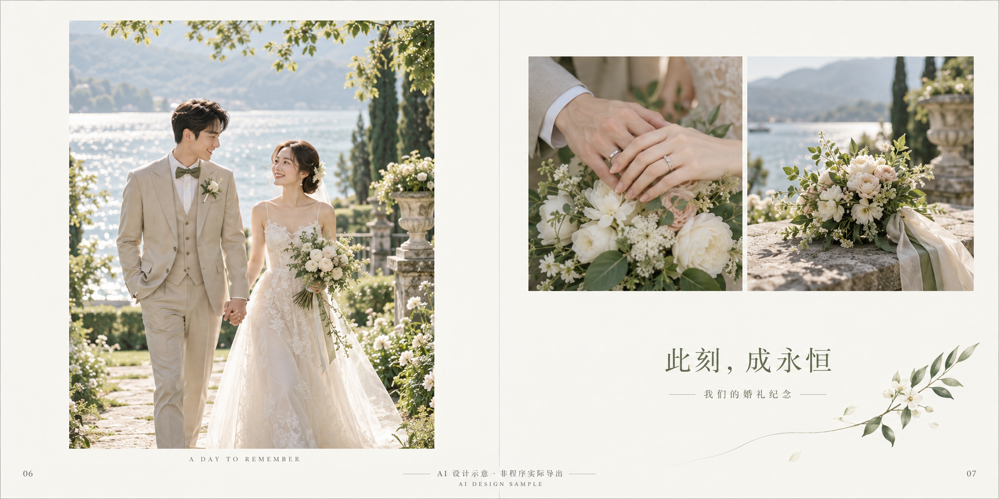

# 相册成品设计样片

## 婚礼相册双页

[打开／下载 PNG 原图](wedding-spread-ai-design-sample.png)

- 场景：婚礼纪念，左页主图、右页细节照片、标题与留白。
- 实际文件：PNG、1774×887 像素、RGB、2:1 双页比例。
- 生成方式：通过图像生成工具创建的原创视觉设计示意，人物与照片均为合成内容。
- 图片内已标注“AI 设计示意 · 非程序实际导出”。

这是用于评审相册成品外观的样片，不能作为已经实现导出引擎、滤镜算法或字体排版的验证结果。目前产品仍处于设计阶段。图中照片和文字是同一张栅格图的一部分，并非可编辑的独立图层。

未来的实际导出应从已保存的相册文档渲染，按尺寸、DPI、出血、字体及素材版本执行。本样片未写入 DPI 和 ICC 配置，也未验证专业印刷。如果按 600×300mm 跨页、300DPI 输出，目标尺寸约为 7087×3543 像素；本图用于屏幕视觉评审，不能直接作为该规格的高清印刷交付。

实际像素、文件 hash 和用途说明记录在 [sample-manifest.json](sample-manifest.json)。本样片单独补充在此目录，之前的 v0.1 文档 ZIP 不包含它。
